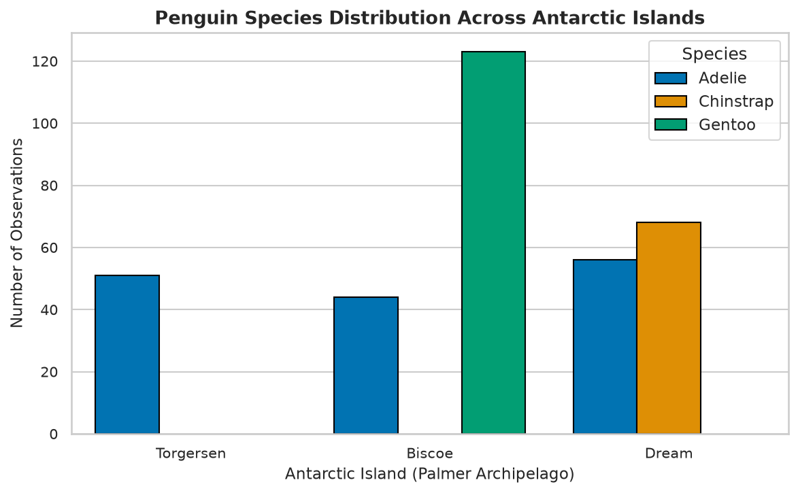
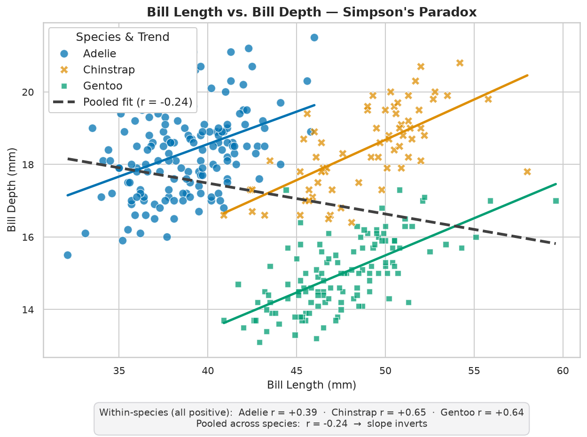
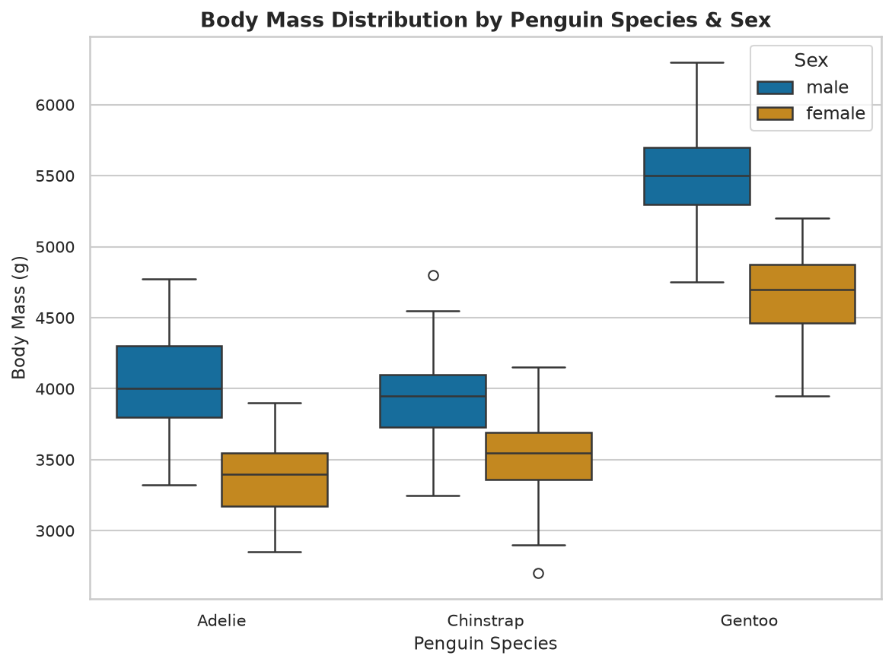
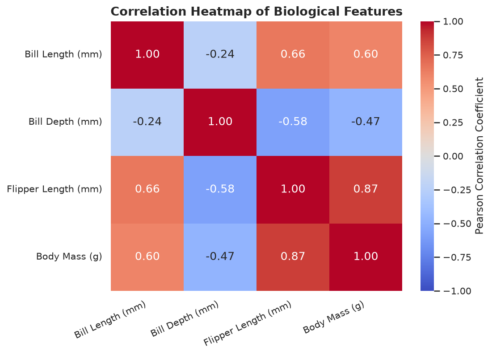
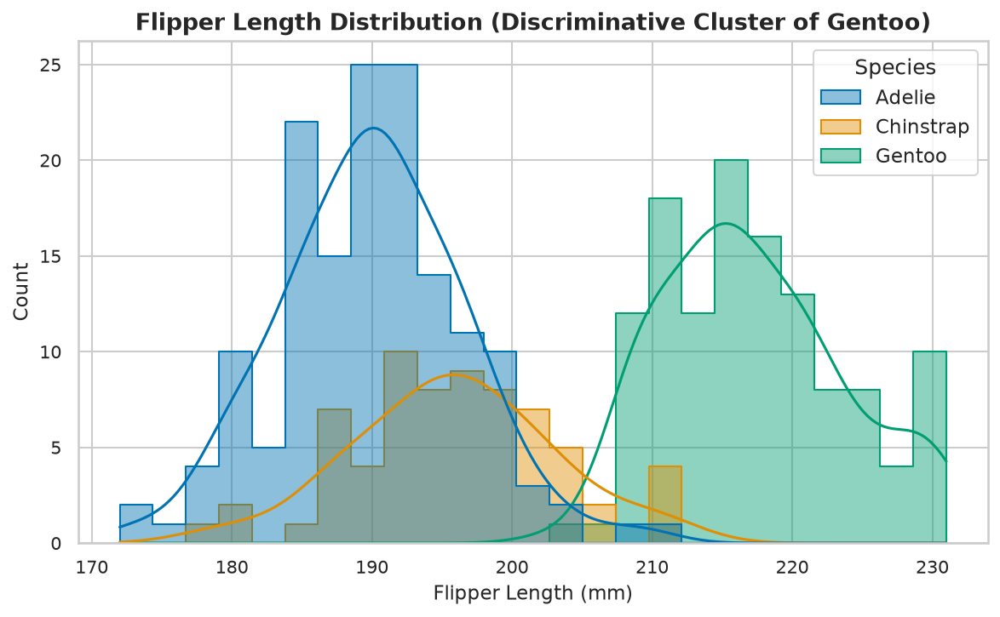

# 🐧 Palmer Penguins — Exploratory Data Analysis (EDA)


> **Professional Exploratory Data Analysis (EDA)** of the Palmer Penguins dataset using Python, Pandas, NumPy, Matplotlib, and Seaborn. Demonstrates clean data engineering, bias-aware missing value treatment, and executive visual storytelling with statistical insights (including **Simpson's Paradox**).
>
> **Every statistic quoted below is verified by an automated test.** If a number in this README ever drifts from the data, CI fails.

---

## 🇬🇧 English (Global Edition)

### Problem & Business Question
What morphological features distinguish the three Antarctic penguin species (*Adélie*, *Chinstrap*, *Gentoo*), and how do these features interact with geographic island distribution and sexual dimorphism? How can we prevent aggregated statistical bias when interpreting biometric relationships?

### Methodology & Approach
1. **Systematic Ingestion & Health Check:** Load `344` raw penguin observations (CC0 license) and inspect schema, data types, and structural integrity.
2. **Bias-Aware Data Hygiene:**
   - Drop the `2` rows lacking *all* core biological measurements (`bill_length_mm`, `bill_depth_mm`, `flipper_length_mm`, `body_mass_g`), leaving `342`.
   - Never impute the categorical `sex` field (`9` missing rows are retained as missing). Imputing it by species mode would manufacture the very sexual dimorphism signal the body-mass analysis is meant to measure.
3. **Exploratory Statistical Profiling:** Compute descriptive statistical profiles across species and islands.
4. **Visual Analytics & Storytelling:** Produce 5 publication-ready charts (150 DPI export) with written executive insights.
5. **Statistical Critical Thinking:** Uncover, *quantify*, and explain **Simpson's Paradox** in bill length vs. depth relationships.

### Tools & Tech Stack
- **Core Languages & Libraries:** Python 3.10+, Pandas, NumPy, Matplotlib, Seaborn, SciPy, statsmodels
- **Interactive Layer:** Streamlit, Plotly
- **Quality:** pytest (43 tests), GitHub Actions CI
- **Standards:** PEP-8, reproducible `requirements.txt`, modular helpers in `src/`

### Key Analytical Results

| Chart | Executive Analytical Insight |
|:---:|:---|
|  | **Geographic Species Segregation:** *Adélie* spans all three islands; *Gentoo* is restricted to Biscoe and *Chinstrap* to Dream. Island geography alone is a high-confidence classifier for the two non-Adélie species. |
|  | **Simpson's Paradox, quantified:** Pooled across the population, bill length and depth correlate **negatively** (`r = -0.24`). Within every species the correlation is **positive** — Adélie `+0.39`, Chinstrap `+0.65`, Gentoo `+0.64`. The sign inverts under aggregation, because Gentoo simply have both longer *and* shallower bills. Any model or LLM summary built on the pooled coefficient states the biology backwards. |
|  | **Mass Hierarchy & Sexual Dimorphism:** *Gentoo* average `5,076 g` — **+37.2%** over Adélie and **+36.0%** over Chinstrap. Adélie and Chinstrap differ by only `32 g`, so mass separates *Gentoo vs. rest*, not all three species. Males outweigh females within every species. |
|  | **Flipper Length ↔ Body Mass (`r = 0.87`):** the strongest pairing in the entire correlation matrix. Flipper length is the best single-variable proxy for overall bird scale. |
|  | **Discriminative Cluster of Gentoo:** a single-feature rule at **207 mm** classifies Gentoo vs. non-Gentoo at **97.7% accuracy** (8 errors in 342 birds). The separation is strong but *not* clean — Gentoo span 203–231 mm while non-Gentoo reach 212 mm, so the groups overlap. The commonly quoted 210 mm cut-off is measurably worse (94.4%). |

### Verification

This repository does not ask you to trust its numbers. Run:

```bash
pytest tests/ -v
```

| Test module | Count | What it locks down |
|:---|:---:|:---|
| `test_statistical_claims.py` | 13 | Every figure quoted in this README, recomputed from the raw CSV |
| `test_data_cleaner.py` | 16 | The cleaning contract: exactly 2 rows dropped, `sex` never imputed, schema validation |
| `test_dashboard.py` | 8 | Streamlit app boots and survives every filter state, including empty selections |
| `test_visualizations.py` | 6 | Chart legends bind each label to its own species colour; the paradox figure really draws both regression layers |

See [`TESTING_REPORT.md`](TESTING_REPORT.md) for the full audit record, including the defects this process caught before release.

### How to Run Locally (3 Modes)

#### Option A: Interactive Web Dashboard GUI (Streamlit)
**Best for Data Analysts, AI Trainer evaluators, and Recruiters** who want a visual, interactive web app to explore data, filter tables, dynamically test Simpson's Paradox, and review AI quality evaluation rubrics:
```bash
# 1. Clone repository
git clone https://github.com/RojasJeanDL/penguins-eda-python.git
cd penguins-eda-python

# 2. Create and activate Python virtual environment
python3 -m venv .venv
source .venv/bin/activate  # Linux/macOS (.venv\Scripts\activate on Windows)

# 3. Install reproducible dependencies
pip install -r requirements.txt

# 4. Launch interactive graphical dashboard in browser
streamlit run app.py
```

Double-click launchers are also available: `run_dashboard.sh` (Linux/macOS), `run_dashboard_windows.bat` (Windows 10/11, auto-creates the venv). On Linux, `bash scripts/install_linux_shortcut.sh` adds an application-menu entry pointing at your clone.

#### Option B: Interactive Narrative Mode (Jupyter Notebook)
For cell-by-cell inspection of the analytical storytelling and Python code. The committed notebook ships **with all outputs and figures rendered**, so it is readable directly on GitHub:
```bash
jupyter notebook notebooks/penguins_eda.ipynb
```

#### Option C: Automated CLI Pipeline Mode (No GUI)
For headless server execution or fast CLI verification:
```bash
python3 src/generate_charts.py
# -> Cleans data and generates all 5 high-resolution PNG figures into images/
```

### Repository Architecture
```
penguins-eda-python/
├── app.py                       # Streamlit dashboard (theme-aware, bilingual, CSV upload)
├── data/
│   └── penguins.csv             # Immutable CC0 dataset (344 rows)
├── src/
│   ├── data_cleaner.py          # Cleaning contract + upload schema validation
│   ├── visualization_utils.py   # Single source of truth for all 5 figures
│   ├── generate_charts.py       # Headless (Agg) PNG export pipeline
│   └── download_dataset.py      # Stdlib-only dataset downloader
├── notebooks/
│   └── penguins_eda.ipynb       # Analytical notebook, committed with outputs
├── tests/                       # 43 pytest checks (claims, cleaning, charts, app)
├── images/                      # Exported 150 DPI figures embedded above
├── scripts/
│   └── install_linux_shortcut.sh
├── .github/workflows/ci.yml     # Tests + chart export + notebook execution
├── run_dashboard.sh             # Linux/macOS launcher
├── run_dashboard_windows.bat    # Windows 10/11 launcher
├── requirements.txt             # Runtime dependencies (tested floors)
├── requirements-dev.txt         # Test dependencies
├── TESTING_REPORT.md            # Bilingual QA audit record
└── LICENSE                      # MIT (code) + CC0 attribution (data)
```

A deliberate design note: the notebook **imports** its figures from `src/visualization_utils.py` rather than re-implementing them. An earlier revision duplicated the plotting code, and a hardcoded legend override drifted into both copies — mislabelling two of the three species in a published chart. One implementation, pinned by tests, makes that class of error impossible.

---

## 🇪🇸 Español (Edición Hispanohablante)

### Problema y Pregunta de Negocio
¿Qué características morfológicas distinguen a las tres especies de pingüinos antárticos (*Adélie*, *Chinstrap*, *Gentoo*) y cómo interaccionan con la isla de origen y el sexo? ¿Cómo evitar sesgos de agregación al interpretar correlaciones biométricas?

### Metodología y Enfoque
1. **Inspección de Salud Operativa:** Carga e inspección de `344` observaciones del dataset público Palmer Penguins (CC0).
2. **Limpieza de Datos sin Sesgos:**
   - Eliminación de las `2` únicas filas sin *ninguna* medición biométrica principal (quedan `342`).
   - Prevención de la imputación de `sex` (se conservan `9` valores ausentes como ausentes). Imputarlo por moda de especie fabricaría la señal de dimorfismo sexual que el análisis de masa corporal pretende medir.
3. **Análisis Exploratorio y Descriptivo:** Evaluación de distribuciones medias y dispersión por especie e isla.
4. **Visualización Estratégica:** 5 visualizaciones exportadas a 150 DPI con explicaciones analíticas adjuntas.
5. **Pensamiento Crítico (Paradoja de Simpson):** Demostración *cuantificada* de cómo la agregación invierte correlaciones reales.

### Resultados y Conclusiones Clave
- **La geografía discrimina especies:** la isla es un predictor fuerte (Gentoo solo en Biscoe; Chinstrap solo en Dream; Adélie en las tres).
- **Paradoja de Simpson demostrada:** en global la correlación pico largo/profundidad es `-0.24`; segmentada por especie es `+0.39`, `+0.65` y `+0.64`. **El signo se invierte al agregar.**
- **Variable reina:** la **longitud de aleta** correlaciona `0.87` con la masa corporal, la relación más fuerte de toda la matriz. Un umbral de **207 mm** clasifica Gentoo frente al resto con **97.7 %** de exactitud (8 errores en 342 aves), aunque los rangos se solapan entre 203 y 212 mm.
- **Adélie y Chinstrap no se separan por masa:** difieren solo `32 g`; hace falta la geometría del pico.

### Verificación

Este repositorio no pide confianza en sus cifras. Ejecuta:

```bash
pytest tests/ -v
```

Las 43 pruebas recalculan cada estadística citada en este README desde el CSV original, validan el contrato de limpieza, comprueban que cada etiqueta de leyenda apunta al color de su propia especie y que el dashboard sobrevive a todos los estados de filtrado. El registro completo de la auditoría — incluidos los defectos que este proceso detectó antes de publicar — está en [`TESTING_REPORT.md`](TESTING_REPORT.md).

### Cómo Ejecutar y Probar Localmente (3 Modos)

#### Opción A: Interfaz Gráfica Web Interactiva (Streamlit Dashboard)
**Recomendado para Analistas de Datos y Reclutadores** que necesitan ver y filtrar datos, explorar gráficos dinámicos con Plotly, probar el interruptor de la Paradoja de Simpson y evaluar rúbricas de AI Training:
```bash
# 1. Clonar el repositorio
git clone https://github.com/RojasJeanDL/penguins-eda-python.git
cd penguins-eda-python

# 2. Crear y activar entorno virtual Python
python3 -m venv .venv
source .venv/bin/activate  # En Linux/macOS (.venv\Scripts\activate en Windows)

# 3. Instalar requerimientos verificados
pip install -r requirements.txt

# 4. Abrir la interfaz gráfica en el navegador
streamlit run app.py
```

También hay lanzadores de doble clic: `run_dashboard.sh` (Linux/macOS) y `run_dashboard_windows.bat` (Windows 10/11, crea el entorno automáticamente). En Linux, `bash scripts/install_linux_shortcut.sh` instala un acceso directo en el menú de aplicaciones apuntando a tu propia copia del repositorio.

#### Opción B: Modo Interactivo de Cuaderno (Jupyter Notebook)
Para auditar la narrativa estadística paso a paso. El cuaderno se publica **con todas sus salidas y figuras renderizadas**, legible directamente en GitHub:
```bash
jupyter notebook notebooks/penguins_eda.ipynb
```

#### Opción C: Modo Automatizado por Consola (CLI Script)
Para verificación en servidores o consolas sin interfaz gráfica:
```bash
python3 src/generate_charts.py
# -> Procesa la limpieza de datos y regenera las 5 imágenes PNG en images/
```

---

### Dataset & License / Licencia

- **Code / Código:** MIT License — see [`LICENSE`](LICENSE).
- **Dataset:** Palmer Penguins, public domain (CC0 1.0), via the Palmer Station LTER program.

```
Horst A.M., Hill A.P., Gorman K.B. (2020). palmerpenguins: Palmer Archipelago
(Antarctica) penguin data. R package version 0.1.0. doi:10.5281/zenodo.3960218

Gorman K.B., Williams T.D., Fraser W.R. (2014). Ecological sexual dimorphism and
environmental variability within a community of Antarctic penguins (genus
Pygoscelis). PLoS ONE 9(3):e90081. doi:10.1371/journal.pone.0090081
```

**Author / Autor:** [Jean Carlos Rojas Herrera (RojasJeanDL)](https://github.com/RojasJeanDL)
**Roles:** AI Trainer (Contractor) · Data Analyst · Python & Power BI Specialist
